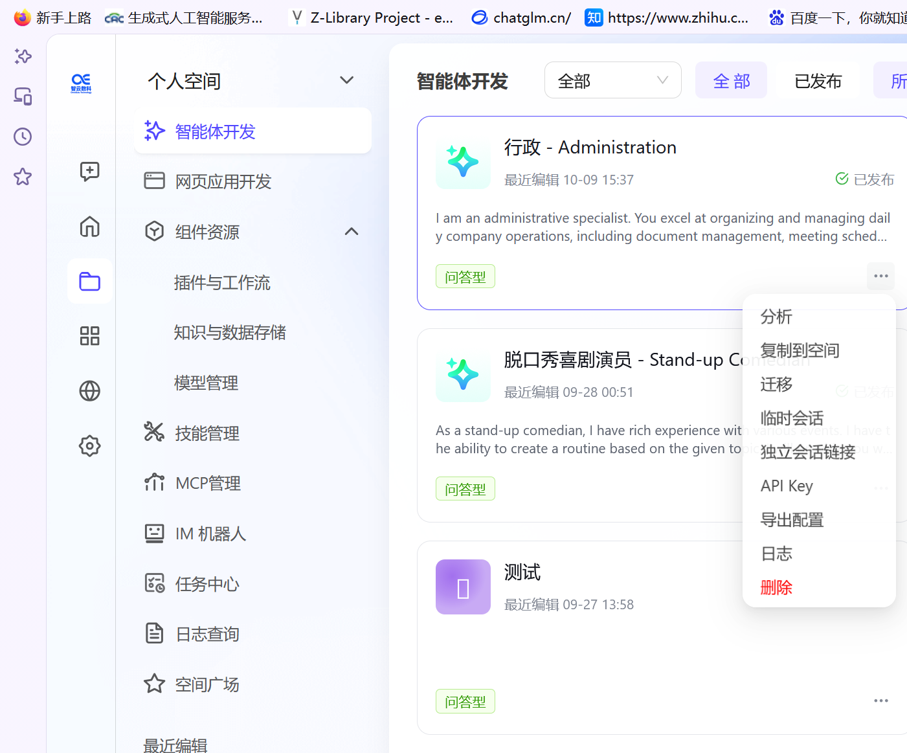
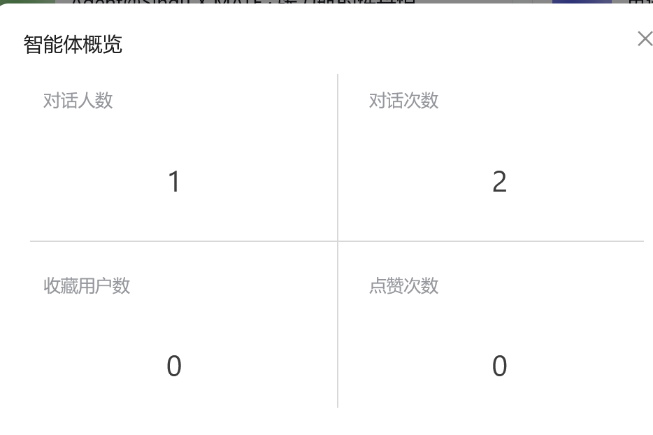
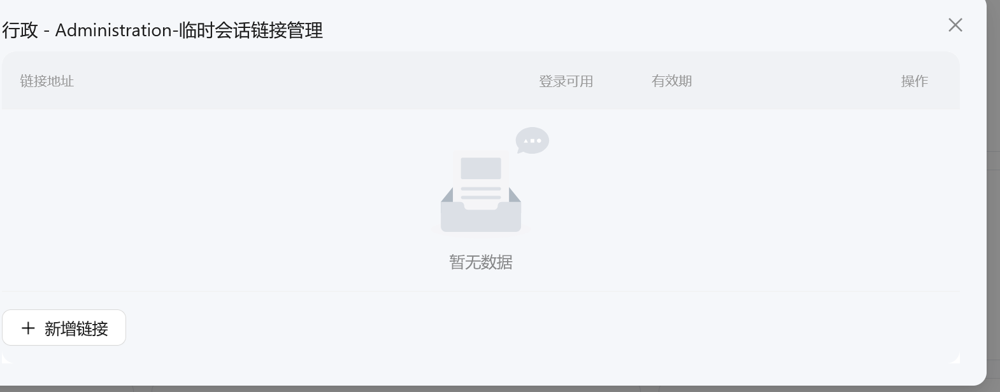
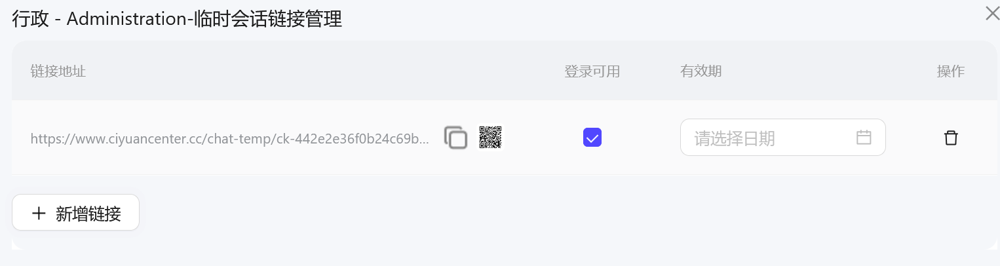
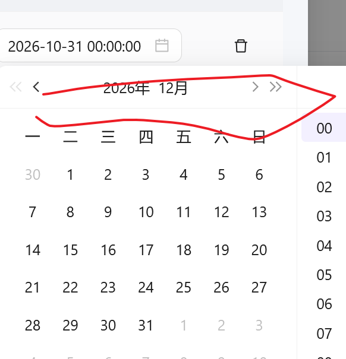
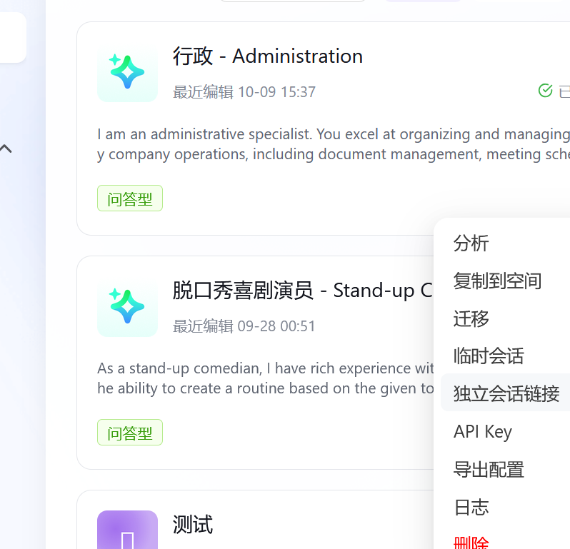
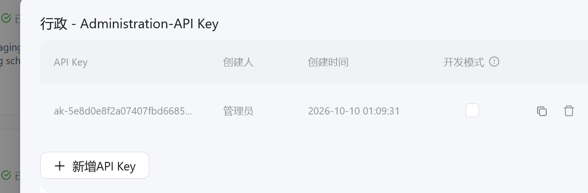
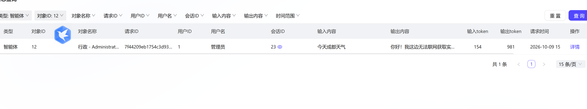
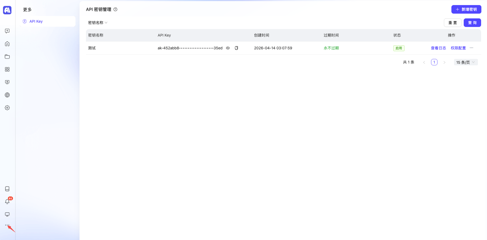

# SinguX 平台智能体与工作流手册

> 本手册面向两类读者：
> - **普通用户**：无需编程基础，跟着图文步骤即可在云端创建、使用并分享自己的智能体（第一篇）。
> - **开发者**：通过开放 API 把智能体接入自己的程序或业务系统（第二篇）。

---

## 目录

### 第一篇　普通用户使用指南

1. [认识 SinguX 平台](#1-认识-singux-平台)
2. [注册、登录与平台入口](#2-注册登录与平台入口)
3. [认识工作空间](#3-认识工作空间)
4. [创建你的第一个智能体](#4-创建你的第一个智能体)
5. [使用、分享与导出智能体](#5-使用分享与导出智能体)
6. [常用能力速览](#6-常用能力速览)
7. [常见问题与使用建议](#7-常见问题与使用建议)

### 第二篇　开放 API 参考（开发者）

8. [使用前准备](#8-使用前准备)
9. [创建会话](#9-创建会话)
10. [开始会话（SSE 流式）](#10-开始会话sse-流式)
11. [查询智能体历史会话](#11-查询智能体历史会话)
12. [查询会话信息](#12-查询会话信息)
13. [更新会话主题](#13-更新会话主题)
14. [查询会话消息列表](#14-查询会话消息列表)
15. [查询会话文件列表](#15-查询会话文件列表)
16. [访问会话文件](#16-访问会话文件)
17. [执行插件](#17-执行插件)
18. [执行工作流](#18-执行工作流)
19. [工作流流式执行](#19-工作流流式执行)
20. [附录：状态码与事件类型速查](#20-附录状态码与事件类型速查)

---
---

# 第一篇　普通用户使用指南

## 1. 认识 SinguX 平台

SinguX 是一套**通用智能体操作系统**，帮助你打造私有的垂类通用智能体：从理解需求、规划任务到交付结果，全链路自动完成。

**你可以用它做什么：**

| 场景 | 说明 |
| --- | --- |
| 知识问答 / 智能客服 | 基于你的资料回答问题，可嵌入网页、公众号或 IM |
| 任务型助手 | 自动联网搜索、发送邮件、生成网页、定时执行任务 |
| 企业智能中台 | 接入私有模型、MCP 工具，通过开放 API 对接业务系统 |

**两种智能体类型：**

| 类型 | 特点 | 适用场景 |
| --- | --- | --- |
| **问答型** | 快问快答，围绕知识与对话 | 知识问答、智能客服、内容生成 |
| **通用型** | 配备独立「执行电脑」，可运行代码、操作文件、调用工具完成多步骤任务 | 自动调研、数据处理、网页报告、复杂自动化 |

> 建议新手从**问答型**开始，熟悉后再尝试通用型。

---

## 2. 注册、登录与平台入口

**第一步：打开平台地址**

在浏览器中访问平台：<https://www.ciyuancenter.cc/>

**第二步：注册 / 登录**

1. 首次使用按页面提示完成注册（通常使用邮箱或手机号）；
2. 已注册用户直接输入账号密码登录；
3. 登录后系统会自动为你创建并进入私有平台。

> **提示**：如果忘记密码，可在登录页通过「忘记密码」入口，使用注册邮箱或手机号找回。

**第三步：进入工作空间**

登录成功后看到的主界面就是工作空间，所有创建和管理操作都从这里开始。

---

## 3. 认识工作空间

工作空间左侧为功能导航栏，主要菜单如下：

| 菜单 | 作用 |
| --- | --- |
| **智能体开发** | 创建、编排、发布和管理智能体（最常用） |
| 网页应用开发 | 创建由智能体驱动的网页应用 |
| **组件资源** | 管理插件与工作流、知识库与数据存储、模型 |
| 技能管理 | 封装可复用的专项能力（Skill） |
| MCP 管理 | 接入标准 MCP 协议的工具与服务 |
| IM 机器人 | 把智能体接入即时通讯工具 |
| 任务中心 | 配置定时、自动执行的任务 |
| 日志查询 | 查询调用与运行日志 |
| **空间广场** | 使用和体验已发布的智能体 |

除「个人空间」外，你还可以创建或加入团队空间，与成员协作开发。

---

## 4. 创建你的第一个智能体

本节以创建一个**问答型智能体**为例，全程约 5 分钟。

### 第 1 步：新建智能体

1. 打开「**智能体开发**」页面；
2. 点击「**创建智能体**」；
3. 在弹窗中选择「**问答型**」（适合知识问答、智能客服等快问快答场景）。

创建成功后会自动跳转到**智能体编排页面**，所有配置都在这里完成。

### 第 2 步：配置系统提示词

系统提示词定义了智能体「是谁、按什么规则做事」。

- **新手推荐**：点击系统提示词右上角的「**优化**」按钮，让 AI 根据你的简单描述自动生成提示词；
- 也可以直接手写。一个最简单的提示词模板：

```text
# Role：知识问答助手
- 你是一名专业的资料问答专家，根据已有资料回答用户问题。

# Rules：
- 只回答与资料相关的问题，不知道就如实说明，不要编造。
- 回答使用中文，条理清晰，先给结论再做说明。
```

> **提示**：提示词写得越具体——角色、规则、输出格式、语气——智能体的表现越稳定。

### 第 3 步：给智能体添加能力

在编排页面为智能体添加**插件**，让它获得联网搜索、发送邮件、网页导出等能力。新手建议先添加「联网搜索」。

后续还可以按需挂载：

- **知识库**：上传文档，让智能体基于你的资料回答（RAG）；
- **数据表**：让智能体读写结构化业务数据；
- **工作流**：把多个处理步骤串成固定流程。

### 第 4 步：发布智能体

配置完成后，点击「**发布**」，智能体才会正式生效并对其他用户可见。

> **提示**：之后每次修改提示词或组件，都需要重新发布才会生效。

### 第 5 步：开始对话

在「**空间广场**」中找到并打开刚发布的智能体，直接输入问题即可开始使用。

如果回答效果不理想，回到编排页面调整提示词或增减插件，重新发布后再试——这是使用智能体最常见的迭代方式。

---

## 5. 使用、分享与导出智能体

在「智能体开发」页面，每个智能体卡片右下角都有一个「**···**」（更多操作）按钮，点击后弹出操作菜单：



菜单包含：分析、复制到空间、迁移、临时会话、独立会话链接、API Key、导出配置、日志、删除。

### 5.1 智能体数据分析

点击「**分析**」，可以查看该智能体的使用数据，例如使用人数、会话数量、收藏与点赞情况等，帮助你了解智能体的受欢迎程度和调用情况。



### 5.2 临时会话（临时分享链接）

临时会话用于生成一个**带有效期**的分享链接，适合短期发给他人试用。

1. 在菜单中点击「**临时会话**」：



2. 在弹出页面点击「**新增链接**」：



3. 选择链接的**有效期**（建议尽量设置得长一些），通过日期时间选择器调整后确认：



4. 链接生成后，可以通过「**复制链接**」或「**二维码**」的方式把智能体分享给他人。对方打开链接即可直接与智能体对话，无需登录你的平台。

> **注意**：临时链接到期后会自动失效，如需长期分享请使用「独立会话链接」。

### 5.3 独立会话链接

「独立会话链接」会为智能体生成一个**长期有效**的独立访问入口，提供给别人即可长期使用。

1. 在菜单中点击「**独立会话链接**」：



2. 在弹窗中可以：
   - 复制独立会话的访问链接 / 二维码，分享给他人；
   - 生成该智能体专属的 **API Key**，之后即可通过自己编写的程序调用智能体：



> **注意**：API Key 相当于访问凭证，请妥善保管、避免泄露；关闭弹窗后无法再次查看完整 Key，如有遗失请重新生成。

### 5.4 其他常用操作

| 菜单项 | 作用 |
| --- | --- |
| **复制到空间** | 把智能体复制一份到其他空间 |
| **迁移** | 将智能体迁移到目标空间 |
| **导出配置** | 导出智能体的配置文件，便于备份或在其他平台导入 |
| **日志** | 导出该智能体的运行日志 |
| **删除** | 删除智能体（**不可恢复**，请谨慎操作） |

### 5.5 查看运行日志

点击「**日志**」并导出后，可以查看智能体每次生成的内容与运行情况，便于排查问题或复盘效果。



### 5.6 创建和管理 API Key（平台级）

除了在智能体菜单中生成专属 Key，你还可以在平台层面统一管理 API Key，并为每个 Key 单独配置可调用的接口范围。

**操作路径**：左下角「更多」菜单 → **API Key 管理**



1. 在 API Key 管理页面点击「**新增**」，创建新的 API Key；
2. 为每个 API Key 配置「**可调用的接口范围**」，灵活控制不同场景下的权限粒度；
3. 创建完成后立即复制并妥善保存 API Key（关闭后无法再次查看完整 Key）。

> **注意事项：**
> - 管理员可在后台控制是否允许普通用户获取 API Key；
> - 建议按使用场景分别创建 Key，并为每个 Key 配置最小必要权限；
> - API Key 是访问凭证，请勿公开分享或提交到代码仓库。

---

## 6. 常用能力速览

| 能力 | 作用 |
| --- | --- |
| 插件 | 把外部能力（联网搜索、邮件发送、网页导出等）挂给智能体 |
| 知识库 | 上传文档做 RAG 问答，支持知识图谱 |
| 数据表 | 类表格数据库，供智能体读写业务数据 |
| 工作流 | 可视化编排多节点处理流程 |
| 技能管理 | 封装可复用的专项能力（Skill） |
| 子智能体 | 由一个主智能体调度多个专职子智能体 |
| MCP | 接入标准 MCP 协议的工具与服务 |
| 任务中心 | 让智能体定时、自动执行任务 |
| 开放 API | 通过 API Key 在你自己的系统中调用智能体 |

---

## 7. 常见问题与使用建议

**Q1：智能体的回答不准确 / 答非所问怎么办？**

按以下顺序排查：

1. 优化**系统提示词**：写清角色、规则、输出格式，必要时点击「优化」按钮重新生成；
2. 检查是否挂载了必要的**插件或知识库**（例如需要最新信息时要挂「联网搜索」）；
3. 确认知识库中的资料是否完整、切分是否合理；
4. 修改后**重新发布**，再次测试。多轮调整是正常过程。

**Q2：修改了配置但效果没变？**

修改提示词或组件后必须重新「**发布**」才会生效。若仅用于调试，可在 API 调用时开启开发模式（`devMode: true`），此时智能体无需发布、变更实时生效。

**Q3：分享给别人的链接打不开了？**

临时会话链接有有效期，到期会失效，请重新生成链接，或改用长期有效的「独立会话链接」。

**Q4：在哪里查看 token 消耗？额度不够怎么办？**

可在智能体「分析」页面和运行日志中查看每次调用的 token 消耗；高频或商用场景如额度不足，可联系平台了解更多额度方案。

**Q5：智能体会不会泄露我的资料？**

云端平台为租户隔离，私有资料仅在你的平台内使用；对数据安全要求高的企业可考虑私有化部署。

**Q6：误删了智能体能恢复吗？**

删除操作不可恢复。建议重要智能体提前使用「导出配置」进行备份。

---
---

# 第二篇　开放 API 参考（开发者）

## 8. 使用前准备

### 8.1 获取 API Key

调用开放 API 前需先获取 API Key，获取方式见第一篇 [5.3](#53-独立会话链接) 与 [5.6](#56-创建和管理-api-key平台级)。

### 8.2 接口基础地址（Base URL）

平台接口基础地址为：`https://www.ciyuancenter.cc`

以下示例均使用该地址，请将示例中的 API Key 替换为你自己的 Key。

### 8.3 公共请求头

| 参数名 | 类型 | 必填 | 描述 | 示例值 |
| --- | --- | --- | --- | --- |
| Authorization | string | 是 | API Key 鉴权 | `Bearer ak-YOUR_API_KEY` |
| singux-user-id | string | 否 | SinguX 用户 ID，仅管理员创建的 API Key 调用时有效，用于身份切换 | `1` |
| singux-user-uid | string | 否 | SinguX 用户 UID，仅管理员创建的 API Key 调用时有效，用于身份切换 | `admin` |
| External-Username | string | 否 | 外部系统用户名，用于日志跟踪 | `张三` |

### 8.4 统一响应结构

所有接口均返回统一结构，业务是否成功以 `code` 是否为 `"0000"` 为准：

| 字段 | 说明 |
| --- | --- |
| code | 业务状态码，`0000` 表示成功，其余为失败 |
| displayCode | 源系统状态码，用于问题跟踪 |
| message | 错误描述信息 |
| data | 业务数据（结构因接口而异） |
| tid | 跟踪唯一标识，排查问题时请提供 |
| success | 请求是否成功 |

---

## 9. 创建会话

### 接口信息

| 项目 | 内容 |
| --- | --- |
| 接口地址 | `/api/v1/chat/conversation/add` |
| 请求方式 | `POST` |
| 请求数据类型 | `application/json` |
| 响应数据类型 | `*/*` |
| 接口描述 | 创建与智能体的新会话 |

### 请求示例

```json
{
  "agentId": 1596,
  "variables": {"key1": "value1"},
  "devMode": true
}
```

### 请求参数

**请求头**

| 参数名 | 类型 | 必填 | 描述 | 示例值 |
| --- | --- | --- | --- | --- |
| Authorization | string | 是 | API Key | `Bearer ak-YOUR_API_KEY` |

**请求体参数**

| 参数名称 | 参数说明 | 是否必须 | 数据类型 |
| --- | --- | --- | --- |
| agentId | 智能体 ID | 是 | integer(int64) |
| variables | 会话变量内容 | 否 | object |
| devMode | 开发模式，为 `true` 时智能体无需发布，变更实时生效 | 否 | boolean |

### 响应参数

| 参数名称 | 参数说明 | 类型 |
| --- | --- | --- |
| code | 业务状态码，0000 表示成功，其余失败 | string |
| displayCode | 源系统状态码，用于问题跟踪 | string |
| message | 错误描述信息 | string |
| data | 创建的会话 ID | integer(int64) |
| tid | 跟踪唯一标识 | string |
| success | 是否成功 | boolean |

### 响应示例

```json
{
  "code": "0000",
  "displayCode": "0000",
  "message": "success",
  "data": 1545548,
  "tid": "2734711776085221044",
  "success": true
}
```

### cURL 示例

```bash
curl 'https://www.ciyuancenter.cc/api/v1/chat/conversation/add' \
  -X POST \
  -H 'Content-Type: application/json' \
  -H 'Authorization: Bearer ak-YOUR_API_KEY' \
  --data-raw '{"agentId": 1596, "variables": {"key1": "value1"}, "devMode": true}'
```

### 测试用例

| # | 场景 | 状态码 | 结果 |
| --- | --- | --- | --- |
| 1 | 创建已发布智能体的会话 | 0000 | 成功，返回会话 ID |
| 2 | 创建会话（携带变量和开发模式） | 0000 | 成功，返回会话 ID |
| 3 | 创建不存在或已下架智能体的会话 | 4000 | 失败，提示"智能体不存在或已下架" |

### TypeScript 模板

```ts
// 请求参数
export interface ConvCreateDto {
  /* 智能体ID */
  agentId: number;
  /* 会话变量内容 */
  variables?: Record<string, unknown>;
  /* 开发模式，为true时，智能体无需发布，变更实时生效 */
  devMode?: boolean;
}

// 响应接口
export interface ConversationCreateRes {
  code: string;
  displayCode: string;
  message: string;
  data: number;
  tid: string;
  success: boolean;
}

/**
 * 创建会话
 * @param params 请求参数
 */
export function createConversation(params: ConvCreateDto): Promise<ConversationCreateRes> {
  return request.post(`/api/v1/chat/conversation/add`, params);
}
```

---

## 10. 开始会话（SSE 流式）

### 接口信息

| 项目 | 内容 |
| --- | --- |
| 接口地址 | `/api/v1/chat/{conversationId}` |
| 请求方式 | `POST` |
| 请求数据类型 | `application/json` |
| 响应数据类型 | `text/event-stream` |
| 接口描述 | 智能体会话接口，响应为 Server-Sent Events (SSE) 流，返回数据为 JSON 格式 |

### 请求示例

```json
{
  "conversationId": 1545551,
  "message": "你好",
  "attachments": [],
  "debug": false,
  "selectedComponents": []
}
```

### 请求参数

**请求头**

| 参数名 | 类型 | 必填 | 描述 | 示例值 |
| --- | --- | --- | --- | --- |
| Authorization | string | 是 | API Key | `Bearer ak-YOUR_API_KEY` |

**路径参数**

| 参数名称 | 参数说明 | 是否必须 | 数据类型 |
| --- | --- | --- | --- |
| conversationId | 会话 ID | 是 | integer(int64) |

**请求体参数**

| 参数名称 | 参数说明 | 是否必须 | 数据类型 |
| --- | --- | --- | --- |
| conversationId | 会话唯一标识 | 是 | integer(int64) |
| variableParams | 变量参数，客户端需根据智能体配置组装 | 否 | object |
| message | 聊天消息 | 否 | string |
| attachments | 附件列表 | 否 | array |
| fileKey | 文件 Key | 否 | string |
| fileUrl | 文件 URL | 是 | string |
| fileName | 文件名称 | 否 | string |
| mimeType | 文件类型 | 是 | string |
| debug | 是否调试模式 | 否 | boolean |
| sandboxId | 用户选择的沙盒（我的电脑）ID | 否 | integer(int64) |
| selectedComponents | 手动选择的组件列表 | 否 | array |
| id | 组件 ID | 否 | integer(int64) |
| type | 组件类型，可用值：`Plugin, Workflow, Trigger, Knowledge, Variable, Database, Model, Agent, Table, Mcp, Page, Event, Skill, SubAgent` | 否 | string |
| skillIds | 客户端选中的技能 ID 列表 | 否 | array |
| filterSensitive | 长期记忆中是否过滤敏感信息 | 否 | boolean |
| modelId | 用户选择的模型 ID | 否 | integer(int64) |

### 响应参数

响应为 SSE 格式的文本流，每个事件包含 `AgentOutputDto` 结构的 JSON 数据：

| 参数名称 | 参数说明 | 类型 |
| --- | --- | --- |
| requestId | 请求唯一编号（任务编号） | string |
| eventType | 事件类型，可用值：`PROCESSING, PROCESSING_MESSAGE, MESSAGE, FINAL_RESULT, HEART_BEAT, ERROR` | string |
| error | 会话出现异常时的错误信息 | string |
| data | 各事件类型对应的数据 | object |
| completed | 输出过程中为 `false`，最后一条消息返回 `true` | boolean |

### 事件说明

#### PROCESSING（工具调用过程）

会话消息输出过程中，智能体可能调用不同工具。`PROCESSING` 消息定义工具调用的开始与结束。

**data 参数说明：**

| 参数名称 | 参数说明 | 类型 |
| --- | --- | --- |
| name | 工具名称 | string |
| icon | 工具图标 | string |
| type | 工具类型，包括 `Mcp, Plugin, Workflow, Table, Knowledge` | string |
| status | 执行状态，`EXECUTING` 执行中，`FINISHED` 执行完成 | string |
| result | 工具执行数据 | object |

#### MESSAGE（消息内容）

| 参数名称 | 参数说明 | 类型 |
| --- | --- | --- |
| id | 消息 ID | string |
| role | 可用值：`USER, ASSISTANT` | string |
| type | 可用值：`CHAT` 普通消息输出，`THINK` 思考消息，`PROCESS_OUTPUT` 工作流过程输出，`QUESTION` 工作流问答节点 | string |
| text | 消息内容 | string |
| time | 消息时间 | string |
| attachments | 消息附件，一般用户消息才有 | array |
| think | 思考内容 | string |
| quotedText | 引用消息内容 | string |
| messageType | 可用值：`USER, ASSISTANT` | string |
| ext | 消息扩展内容 | array |
| finished | 消息内容是否输出结束 | boolean |

#### HEARTBEAT（心跳）

收到 `HEARTBEAT` 事件时可直接忽略。

#### FINAL_RESULT（最终结果）

会话结束后的最终结果，包含 token 使用统计和汇总消息内容。

| 参数名称 | 参数说明 | 类型 |
| --- | --- | --- |
| success | 执行成功状态 | boolean |
| error | 执行失败信息 | string |
| startTime | 开始时间戳（毫秒） | number |
| endTime | 结束时间戳（毫秒） | number |
| completionTokens | 输出 token 数 | integer |
| promptTokens | 输入提示词 token 数 | integer |
| totalTokens | 总计 token 数 | integer |
| outputText | 汇总输出消息内容 | string |

### cURL 示例

```bash
curl -N 'https://www.ciyuancenter.cc/api/v1/chat/1545551' \
  -X POST \
  -H 'Content-Type: application/json' \
  -H 'Authorization: Bearer ak-YOUR_API_KEY' \
  --data-raw '{"conversationId": 1545551, "message": "你好"}'
```

### TypeScript 模板

```ts
// 附件信息
export interface AttachmentDto {
  fileKey?: string;
  fileUrl: string;
  fileName?: string;
  mimeType: string;
}

// 手动选择的组件
export interface SelectedComponentDto {
  id: number;
  type?: 'Plugin' | 'Workflow' | 'Trigger' | 'Knowledge' | 'Variable' | 'Database'
    | 'Model' | 'Agent' | 'Table' | 'Mcp' | 'Page' | 'Event' | 'Skill' | 'SubAgent';
}

// 请求参数
export interface TryReqDto {
  conversationId: number;
  variableParams?: Record<string, unknown>;
  message?: string;
  attachments?: AttachmentDto[];
  debug?: boolean;
  sandboxId?: number;
  selectedComponents?: SelectedComponentDto[];
  skillIds?: number[];
  filterSensitive?: boolean;
  modelId?: number;
}

// 响应事件
export interface AgentOutputDto {
  requestId?: string;
  eventType?: 'PROCESSING' | 'PROCESSING_MESSAGE' | 'MESSAGE'
    | 'FINAL_RESULT' | 'HEART_BEAT' | 'ERROR';
  error?: string;
  data?: unknown;
  completed?: boolean;
}

/**
 * 开始会话（SSE 流式响应）
 * @param conversationId 会话 ID
 * @param params 请求参数
 */
export function startChat(conversationId: number, params: TryReqDto): Promise<void> {
  return request.post(`/api/v1/chat/${conversationId}`, params, {
    responseType: 'text',
    onDownloadProgress: (event) => {
      // 在此处理 SSE 事件流
    }
  });
}
```

---

## 11. 查询智能体历史会话

### 接口信息

| 项目 | 内容 |
| --- | --- |
| 接口地址 | `/api/v1/chat/conversation/list` |
| 请求方式 | `GET` |
| 请求数据类型 | 无 |
| 响应数据类型 | `*/*` |
| 接口描述 | 查询指定智能体的历史会话列表，使用游标分页（通过 lastId 翻页） |

### 请求示例

```text
GET /api/v1/chat/conversation/list?agentId=1596&limit=5
```

### 请求参数

**查询参数**

| 参数名称 | 参数说明 | 是否必须 | 数据类型 | 默认值 |
| --- | --- | --- | --- | --- |
| agentId | 智能体 ID | 是 | integer(int64) | |
| lastId | 最后一条会话 ID，用于翻页 | 否 | integer(int64) | |
| limit | 返回数量限制 | 否 | integer(int32) | 10 |
| topic | 按会话主题模糊搜索 | 否 | string | |

### 响应参数（data 为会话数组，单条结构）

| 参数名称 | 参数说明 | 类型 |
| --- | --- | --- |
| id | 会话 ID | integer(int64) |
| tenantId | 租户 ID | integer(int64) |
| userId | 用户 ID | integer(int64) |
| uid | 会话 UUID | string |
| agentId | 智能体 ID | integer(int64) |
| topic | 会话主题 | string |
| summary | 会话摘要 | string |
| variables | 用户填写的会话变量内容 | object |
| modified | 修改时间 | string(date-time) |
| created | 创建时间 | string(date-time) |
| agent | 智能体信息 | object(AgentDetailDto) |
| type | 会话类型，可用值：`Chat, TempChat, TASK, TaskCenter` | string |
| taskId | 任务 ID | string |
| taskStatus | 任务状态，可用值：`CREATE, EXECUTING, CANCEL, COMPLETE, FAILED` | string |
| taskCron | 定时任务表达式 | string |
| taskCronDesc | 定时任务表达式描述 | string |
| devMode | 开发模式 | integer(int32) |
| topicUpdated | 主题是否更新 | integer(int32) |
| sandboxServerId | 沙盒服务器 ID | string |
| sandboxSessionId | 沙盒会话 ID | string |
| sharedUris | 已分享的 URI 地址 | array |

### 响应示例

```json
{
  "code": "0000",
  "displayCode": "0000",
  "message": "success",
  "data": [
    {
      "id": 1545552,
      "tenantId": 1,
      "userId": 1,
      "uid": "3787cf89001f43bd832b7adeb8134d96",
      "agentId": 1596,
      "topic": "自定义会话主题",
      "summary": null,
      "variables": null,
      "modified": "2026-04-13T13:07:54.000+00:00",
      "created": "2026-04-13T13:07:10.000+00:00",
      "agent": {
        "agentId": 1596,
        "type": "TaskAgent",
        "name": "TaskAgentTest",
        "hasPermission": false,
        "collect": false
      },
      "messageList": null,
      "type": "Chat",
      "taskId": null,
      "taskStatus": "CREATE",
      "taskCron": null,
      "taskCronDesc": "",
      "devMode": 0,
      "topicUpdated": 1,
      "sandboxServerId": null,
      "sandboxSessionId": null,
      "sharedUris": null
    }
  ],
  "tid": "4361141776087082287",
  "success": true
}
```

### cURL 示例

```bash
# 查询前 5 条会话
curl 'https://www.ciyuancenter.cc/api/v1/chat/conversation/list?agentId=1596&limit=5' \
  -H 'Authorization: Bearer ak-YOUR_API_KEY'

# 翻页查询
curl 'https://www.ciyuancenter.cc/api/v1/chat/conversation/list?agentId=1596&lastId=1545552&limit=5' \
  -H 'Authorization: Bearer ak-YOUR_API_KEY'

# 按主题搜索
curl 'https://www.ciyuancenter.cc/api/v1/chat/conversation/list?agentId=1596&topic=Greeting' \
  -H 'Authorization: Bearer ak-YOUR_API_KEY'
```

### 测试用例

| # | 场景 | 状态码 | 结果 |
| --- | --- | --- | --- |
| 1 | 查询历史会话（默认分页） | 0000 | 成功，返回最近 10 条会话 |
| 2 | 查询历史会话（指定 limit） | 0000 | 成功，返回指定数量的会话 |
| 3 | 翻页查询（传入 lastId） | 0000 | 成功，返回 lastId 之后的会话 |
| 4 | 按主题搜索会话 | 0000 | 成功，返回匹配的会话列表 |

### TypeScript 模板

```ts
export interface ConversationDto {
  id: number;
  tenantId?: number;
  userId?: number;
  uid?: string;
  agentId?: number;
  topic?: string;
  summary?: string;
  variables?: Record<string, unknown>;
  modified?: string;
  created?: string;
  agent?: unknown;
  messageList?: unknown[];
  type?: 'Chat' | 'TempChat' | 'TASK' | 'TaskCenter';
  taskId?: string;
  taskStatus?: 'CREATE' | 'EXECUTING' | 'CANCEL' | 'COMPLETE' | 'FAILED';
  taskCron?: string;
  taskCronDesc?: string;
  devMode?: number;
  topicUpdated?: number;
  sandboxServerId?: string;
  sandboxSessionId?: string;
  sharedUris?: string[];
}

export interface ConversationListRes {
  code: string;
  displayCode: string;
  message: string;
  data: ConversationDto[];
  tid: string;
  success: boolean;
}

/**
 * 查询智能体历史会话
 */
export function getConversationList(
  agentId: number,
  params?: { lastId?: number; limit?: number; topic?: string }
): Promise<ConversationListRes> {
  const query = new URLSearchParams();
  query.set('agentId', String(agentId));
  if (params?.lastId !== undefined) query.set('lastId', String(params.lastId));
  if (params?.limit !== undefined) query.set('limit', String(params.limit));
  if (params?.topic !== undefined) query.set('topic', params.topic);
  return request.get(`/api/v1/chat/conversation/list?${query}`);
}
```

---

## 12. 查询会话信息

### 接口信息

| 项目 | 内容 |
| --- | --- |
| 接口地址 | `/api/v1/chat/conversation/{id}` |
| 请求方式 | `GET` |
| 请求数据类型 | 无 |
| 响应数据类型 | `*/*` |
| 接口描述 | 查询指定会话的详细信息，包含会话中的历史消息 |

### 请求示例

```text
GET /api/v1/chat/conversation/1545551
```

### 路径参数

| 参数名称 | 参数说明 | 是否必须 | 数据类型 |
| --- | --- | --- | --- |
| id | 会话 ID | 是 | integer(int64) |

### 响应参数

`data` 为会话信息对象（结构同[第 11 节](#11-查询智能体历史会话)的会话字段），并额外包含：

| 参数名称 | 参数说明 | 类型 |
| --- | --- | --- |
| messageList | 会话消息列表 | array(ChatMessageDto) |

### 响应示例

```json
{
  "code": "0000",
  "displayCode": "0000",
  "message": "success",
  "data": {
    "id": 1545551,
    "tenantId": 1,
    "userId": 1,
    "uid": "c1e2c0c32a844127a829560641b9da57",
    "agentId": 1596,
    "topic": "和 TaskAgentTest 开始会话",
    "summary": null,
    "variables": null,
    "modified": "2026-04-13T13:02:25.000+00:00",
    "created": "2026-04-13T13:02:25.000+00:00",
    "agent": {
      "spaceId": 57,
      "creatorId": 1,
      "agentId": 1596,
      "uid": "255233c81c144196819426878d7449bf",
      "type": "TaskAgent",
      "name": "TaskAgentTest",
      "description": null,
      "remark": null,
      "publishDate": "2026-04-05T16:35:39.000+00:00",
      "statistics": {
        "targetId": 1596,
        "userCount": 17,
        "convCount": 964,
        "collectCount": 2,
        "likeCount": 0
      },
      "category": "BusinessService",
      "openSuggest": "Close",
      "manualComponents": [],
      "allowCopy": 1,
      "hasPermission": true,
      "allowOtherModel": 1,
      "allowAtSkill": 1,
      "allowPrivateSandbox": 1,
      "collect": false
    },
    "messageList": null,
    "type": "Chat",
    "taskId": null,
    "taskStatus": "CREATE",
    "taskCronDesc": "",
    "devMode": 0,
    "topicUpdated": 0,
    "sandboxServerId": null,
    "sandboxSessionId": null,
    "sharedUris": null
  },
  "tid": "8681381776085355631",
  "success": true
}
```

### cURL 示例

```bash
curl 'https://www.ciyuancenter.cc/api/v1/chat/conversation/1545551' \
  -H 'Authorization: Bearer ak-YOUR_API_KEY'
```

### 测试用例

| # | 场景 | 状态码 | 结果 |
| --- | --- | --- | --- |
| 1 | 查询存在的会话 | 0000 | 成功，返回会话详细信息（含智能体信息） |

### TypeScript 模板

```ts
export interface ConversationQueryRes {
  code: string;
  displayCode: string;
  message: string;
  data: ConversationDto;
  tid: string;
  success: boolean;
}

/**
 * 查询会话信息
 * @param id 会话 ID
 */
export function getConversation(id: number): Promise<ConversationQueryRes> {
  return request.get(`/api/v1/chat/conversation/${id}`);
}
```

---

## 13. 更新会话主题

### 接口信息

| 项目 | 内容 |
| --- | --- |
| 接口地址 | `/api/v1/chat/conversation/{conversationId}/update` |
| 请求方式 | `POST` |
| 请求数据类型 | `application/json` |
| 响应数据类型 | `*/*` |
| 接口描述 | 更新指定会话的主题名称，可通过 `firstMessage` 或 `topic` 设置，二者至少提供一个 |

### 请求示例

```json
{
  "firstMessage": "你好，请问今天天气怎么样？"
}
```

### 请求体参数

| 参数名称 | 参数说明 | 是否必须 | 数据类型 |
| --- | --- | --- | --- |
| firstMessage | 用户第一条消息 | 是 | string |
| topic | 会话主题，可与 firstMessage 二选一 | 否 | string |

### 响应参数

`data` 为更新后的会话信息（ConversationDto）。

### 响应示例

```json
{
  "code": "0000",
  "displayCode": "0000",
  "message": "success",
  "data": {
    "id": 1545552,
    "tenantId": 1,
    "userId": 1,
    "uid": "3787cf89001f43bd832b7adeb8134d96",
    "agentId": 1596,
    "topic": "自定义会话主题",
    "summary": null,
    "variables": null,
    "modified": "2026-04-13T13:07:54.000+00:00",
    "created": "2026-04-13T13:07:10.000+00:00",
    "agent": {
      "agentId": 1596,
      "name": "TaskAgentTest",
      "type": "TaskAgent"
    },
    "messageList": null,
    "type": "Chat",
    "taskId": null,
    "taskStatus": "CREATE",
    "devMode": 0,
    "topicUpdated": 1
  },
  "tid": "2798491776085673993",
  "success": true
}
```

### cURL 示例

```bash
curl 'https://www.ciyuancenter.cc/api/v1/chat/conversation/1545552/update' \
  -X POST \
  -H 'Content-Type: application/json' \
  -H 'Authorization: Bearer ak-YOUR_API_KEY' \
  --data-raw '{"firstMessage": "你好，请问今天天气怎么样？"}'
```

### 测试用例

| # | 场景 | 状态码 | 结果 |
| --- | --- | --- | --- |
| 1 | 使用 firstMessage 更新主题 | 0000 | 成功，主题更新为第一条消息内容 |
| 2 | 使用 topic 更新主题 | 0000 | 成功，主题更新为自定义内容 |

### TypeScript 模板

```ts
export interface ConversationUpdateDto {
  /* 用户第一条消息 */
  firstMessage: string;
  /* 会话主题，可与 firstMessage 二选一 */
  topic?: string;
}

export interface ConversationUpdateRes {
  code: string;
  displayCode: string;
  message: string;
  data: ConversationDto;
  tid: string;
  success: boolean;
}

/**
 * 更新会话主题
 */
export function updateConversation(
  conversationId: number,
  params: ConversationUpdateDto
): Promise<ConversationUpdateRes> {
  return request.post(`/api/v1/chat/conversation/${conversationId}/update`, params);
}
```

---

## 14. 查询会话消息列表

### 接口信息

| 项目 | 内容 |
| --- | --- |
| 接口地址 | `/api/v1/chat/{conversationId}/messages` |
| 请求方式 | `GET` |
| 请求数据类型 | 无 |
| 响应数据类型 | `*/*` |
| 接口描述 | 查询指定会话中的消息列表，支持分页查询 |

### 请求示例

```text
GET /api/v1/chat/1545556/messages?index=174590&limit=10
```

### 查询参数

| 参数名称 | 参数说明 | 是否必须 | 数据类型 | 默认值 |
| --- | --- | --- | --- | --- |
| index | 消息索引起始位置 | 否 | integer(int64) | |
| limit | 返回消息数量限制 | 否 | integer(int32) | 10 |

### 响应参数（data 为消息数组，单条结构 ChatMessageDto）

| 参数名称 | 参数说明 | 类型 |
| --- | --- | --- |
| index | 消息索引 | integer(int64) |
| tenantId | 租户 ID | integer(int64) |
| senderType | 消息发送方类型，可用值：`USER, AGENT` | string |
| senderId | 消息发送方 ID | string |
| userId | 关联用户 ID | integer(int64) |
| agentId | 关联的智能体 ID | integer(int64) |
| id | 消息 ID | string |
| role | 消息角色，可用值：`USER, ASSISTANT, SYSTEM, FUNCTION` | string |
| type | 消息类型，可用值：`CHAT, THINK, PROCESS_OUTPUT, QUESTION, ANSWER` | string |
| text | 消息内容 | string |
| time | 消息时间 | string(date-time) |
| attachments | 消息附件 | array(AttachmentDto) |
| fileKey | 文件 Key | string |
| fileUrl | 文件 URL | string |
| fileName | 文件名称 | string |
| mimeType | 文件类型 | string |
| think | 思考内容 | string |
| quotedText | 引用消息内容 | string |
| finished | 消息内容是否输出结束 | boolean |
| finishReason | 完成原因 | string |
| componentExecutedList | 执行过程输出数据 | array |
| metadata | 消息扩展内容 | object |
| messageType | 消息类型，可用值：`USER, ASSISTANT, SYSTEM, TOOL` | string |

### 响应示例

```json
{
  "code": "0000",
  "displayCode": "0000",
  "message": "success",
  "data": [
    {
      "index": 174590,
      "tenantId": 1,
      "senderType": "USER",
      "senderId": "1",
      "userId": 1,
      "agentId": 1596,
      "id": "d5be409c98f44928bcb1cd5a935912cf",
      "role": "USER",
      "type": "CHAT",
      "text": "帮我做一个简单的天气卡片网页，包含温度、天气图标和位置信息",
      "time": "2026-04-13T13:19:09.000+00:00",
      "attachments": null,
      "think": null,
      "quotedText": null,
      "finished": false,
      "finishReason": null,
      "componentExecutedList": null,
      "metadata": null,
      "messageType": "USER"
    },
    {
      "index": 174591,
      "tenantId": 1,
      "senderType": "AGENT",
      "senderId": "1596",
      "userId": 1,
      "agentId": 1596,
      "id": "abc123",
      "role": "ASSISTANT",
      "type": "CHAT",
      "text": "你好！我是一个天气卡片...",
      "time": "2026-04-13T13:19:15.000+00:00",
      "attachments": null,
      "think": null,
      "quotedText": null,
      "finished": true,
      "finishReason": "ENDTURN",
      "componentExecutedList": [],
      "metadata": null,
      "messageType": "ASSISTANT"
    }
  ],
  "tid": "6044751776086475149",
  "success": true
}
```

### cURL 示例

```bash
curl 'https://www.ciyuancenter.cc/api/v1/chat/1545556/messages?index=174590&limit=10' \
  -H 'Authorization: Bearer ak-YOUR_API_KEY'
```

### 测试用例

| # | 场景 | 状态码 | 结果 |
| --- | --- | --- | --- |
| 1 | 查询会话消息（默认分页） | 0000 | 成功，返回最近 10 条消息 |
| 2 | 查询会话消息（指定起始索引） | 0000 | 成功，从指定索引开始返回 |

### TypeScript 模板

```ts
export interface ConversationMessagesRes {
  code: string;
  displayCode: string;
  message: string;
  data: ChatMessageDto[];
  tid: string;
  success: boolean;
}

/**
 * 查询会话消息列表
 */
export function getConversationMessages(
  conversationId: number,
  index?: number,
  limit?: number
): Promise<ConversationMessagesRes> {
  const params = new URLSearchParams();
  if (index !== undefined) params.set('index', String(index));
  if (limit !== undefined) params.set('limit', String(limit));
  const query = params.toString() ? `?${params}` : '';
  return request.get(`/api/v1/chat/${conversationId}/messages${query}`);
}
```

---

## 15. 查询会话文件列表

### 接口信息

| 项目 | 内容 |
| --- | --- |
| 接口地址 | `/api/v1/chat/{conversationId}/files` |
| 请求方式 | `GET` |
| 请求数据类型 | 无 |
| 响应数据类型 | `*/*` |
| 接口描述 | 查询指定会话中的文件列表（例如通用型智能体执行任务时生成的文件） |

### 请求示例

```text
GET /api/v1/chat/1545555/files
```

### 响应参数

`data` 为文件列表容器：

| 参数名称 | 参数说明 | 类型 |
| --- | --- | --- |
| files | 文件列表 | array(FileItem) |

**FileItem 结构：**

| 参数名称 | 参数说明 | 类型 |
| --- | --- | --- |
| name | 文件路径 | string |
| isDir | 是否为目录 | boolean |
| fileProxyUrl | 文件代理 URL，用于访问该文件 | string |
| isLink | 是否为链接 | boolean |

### 响应示例

```json
{
  "code": "0000",
  "displayCode": "0000",
  "message": "success",
  "data": {
    "files": [
      {
        "name": "html/index.html",
        "isDir": false,
        "fileProxyUrl": "/api/v1/chat/1544687/file/html/index.html",
        "isLink": false
      }
    ]
  },
  "tid": "4730801776086909275",
  "success": true
}
```

### cURL 示例

```bash
curl 'https://www.ciyuancenter.cc/api/v1/chat/1544687/files' \
  -H 'Authorization: Bearer ak-YOUR_API_KEY'
```

### 测试用例

| # | 场景 | 状态码 | 结果 |
| --- | --- | --- | --- |
| 1 | 查询会话文件列表 | 0000 | 成功，返回文件列表（无文件时为空数组） |

### TypeScript 模板

```ts
export interface FileItem {
  name: string;
  isDir: boolean;
  fileProxyUrl: string;
  isLink: boolean;
}

export interface ComputerFileListRes {
  files: FileItem[];
}

export interface ConversationFilesRes {
  code: string;
  displayCode: string;
  message: string;
  data: ComputerFileListRes;
  tid: string;
  success: boolean;
}

/**
 * 查询会话文件列表
 */
export function getConversationFiles(conversationId: number): Promise<ConversationFilesRes> {
  return request.get(`/api/v1/chat/${conversationId}/files`);
}
```

---

## 16. 访问会话文件

### 接口信息

| 项目 | 内容 |
| --- | --- |
| 接口地址 | `/api/v1/chat/{conversationId}/file/**` |
| 请求方式 | `GET` |
| 请求数据类型 | 无 |
| 响应数据类型 | `*/*`（二进制流） |
| 接口描述 | 静态文件访问，返回二进制流（图片、文件等）；文件相对路径通过[第 15 节](#15-查询会话文件列表)返回的 `fileProxyUrl` 获取 |

### 请求示例

```text
GET /api/v1/chat/1544687/file/html/index.html
```

`file/**` 中 `**` 部分为文件的相对路径。

### cURL 示例

```bash
# 下载文件到本地
curl 'https://www.ciyuancenter.cc/api/v1/chat/1544687/file/html/index.html' \
  -H 'Authorization: Bearer ak-YOUR_API_KEY' \
  -o index.html
```

### TypeScript 模板

```ts
/**
 * 访问会话文件
 * @param conversationId 会话 ID
 * @param filePath 文件相对路径
 */
export function getConversationFile(
  conversationId: number,
  filePath: string
): Promise<Blob> {
  return request.get(`/api/v1/chat/${conversationId}/file/${filePath}`, {
    responseType: 'blob'
  });
}
```

---

## 17. 执行插件

### 接口信息

| 项目 | 内容 |
| --- | --- |
| 接口地址 | `/api/v1/plugin/{id}/execute` |
| 请求方式 | `POST` |
| 请求数据类型 | `application/json` |
| 响应数据类型 | `*/*` |
| 接口描述 | 运行指定插件，请求体为动态参数，按插件定义的入参传递 |

### 请求示例

```json
{
  "query": "test",
  "count": 5
}
```

### 路径参数

| 参数名称 | 参数说明 | 是否必须 | 数据类型 |
| --- | --- | --- | --- |
| id | 插件 ID | 是 | integer(int64) |

### 请求体参数

动态参数，根据插件定义的入参传递对应的 key-value 键值对。

### 响应参数

`data` 为插件执行返回的结果（结构因插件而异）。

### 响应示例

```json
{
  "code": "0000",
  "displayCode": "0000",
  "message": "success",
  "data": null,
  "tid": "3103671776084713674",
  "success": true
}
```

### cURL 示例

```bash
curl 'https://www.ciyuancenter.cc/api/v1/plugin/100/execute' \
  -X POST \
  -H 'Content-Type: application/json' \
  -H 'Authorization: Bearer ak-YOUR_API_KEY' \
  --data-raw '{"query": "test", "count": 5}'
```

### 测试用例

| # | 场景 | 状态码 | 结果 |
| --- | --- | --- | --- |
| 1 | 执行已发布的插件 | 0000 | 成功，返回插件执行结果 |
| 2 | 执行不存在或未发布的插件 | 0001 | 失败，提示 "Error plugin id or not published" |

### TypeScript 模板

```ts
export interface PluginExecuteRes {
  code: string;
  displayCode: string;
  message: string;
  data: object | null;
  tid: string;
  success: boolean;
}

/**
 * 执行插件
 * @param id 插件 ID
 * @param params 插件动态入参
 */
export function executePlugin(
  id: number,
  params: Record<string, unknown>
): Promise<PluginExecuteRes> {
  return request.post(`/api/v1/plugin/${id}/execute`, params);
}
```

---

## 18. 执行工作流

### 接口信息

| 项目 | 内容 |
| --- | --- |
| 接口地址 | `/api/v1/workflow/{id}/execute` |
| 请求方式 | `POST` |
| 请求数据类型 | `application/json` |
| 响应数据类型 | `*/*` |
| 接口描述 | 运行指定工作流，请求体为动态参数，按工作流定义的入参传递 |

### 请求示例

```json
{
  "question": "用户输入的问题"
}
```

### 路径参数

| 参数名称 | 参数说明 | 是否必须 | 数据类型 |
| --- | --- | --- | --- |
| id | 工作流 ID | 是 | integer(int64) |

### 请求体参数

动态参数，根据工作流定义的入参传递对应的 key-value 键值对。

### 响应参数

`data` 为工作流执行返回的结果。

### 响应示例

```json
{
  "code": "0000",
  "displayCode": "0000",
  "message": "success",
  "data": {},
  "tid": "1234567890123456789",
  "success": true
}
```

### cURL 示例

```bash
curl 'https://www.ciyuancenter.cc/api/v1/workflow/20/execute' \
  -X POST \
  -H 'Content-Type: application/json' \
  -H 'Authorization: Bearer ak-YOUR_API_KEY' \
  --data-raw '{"question": "用户输入问题"}'
```

### 测试用例

| # | 场景 | 状态码 | 结果 |
| --- | --- | --- | --- |
| 1 | 执行已发布的工作流 | 0000 | 成功，返回工作流执行结果 |
| 2 | 执行不存在或未发布的工作流 | 0001 | 失败，提示 "Error workflow id or not published" |

### TypeScript 模板

```ts
export interface WorkflowExecuteRes {
  code: string;
  displayCode: string;
  message: string;
  data: object | null;
  tid: string;
  success: boolean;
}

/**
 * 执行工作流
 * @param id 工作流 ID
 * @param params 工作流动态入参
 */
export function executeWorkflow(
  id: number,
  params: Record<string, unknown>
): Promise<WorkflowExecuteRes> {
  return request.post(`/api/v1/workflow/${id}/execute`, params);
}
```

---

## 19. 工作流流式执行

### 接口信息

| 项目 | 内容 |
| --- | --- |
| 接口地址 | `/api/v1/workflow/{id}/sse/execute` |
| 请求方式 | `POST` |
| 请求数据类型 | `application/json` |
| 响应数据类型 | `text/event-stream` |
| 接口描述 | 流式运行指定工作流，请求体为动态参数；响应为 SSE 流，返回工作流执行的中间结果 |

### 请求示例

```json
{
  "question": "用户输入的问题"
}
```

### 路径参数

| 参数名称 | 参数说明 | 是否必须 | 数据类型 |
| --- | --- | --- | --- |
| id | 工作流 ID | 是 | integer(int64) |

### 请求体参数

动态参数，根据工作流定义的入参传递对应的 key-value 键值对。

### cURL 示例

```bash
curl 'https://www.ciyuancenter.cc/api/v1/workflow/20/sse/execute' \
  -X POST \
  -H 'Content-Type: application/json' \
  -H 'Authorization: Bearer ak-YOUR_API_KEY' \
  --data-raw '{"question": "用户输入问题"}'
```

### 测试用例

| # | 场景 | 结果 |
| --- | --- | --- |
| 1 | 流式执行已发布的工作流 | 成功，返回 SSE 事件流 |
| 2 | 流式执行不存在或未发布的工作流 | 失败，返回错误响应 |

### TypeScript 模板

```ts
/**
 * 工作流流式执行
 * @param id 工作流 ID
 * @param params 工作流动态入参
 */
export function streamExecuteWorkflow(
  id: number,
  params: Record<string, unknown>
): Promise<void> {
  return request.post(`/api/v1/workflow/${id}/sse/execute`, params, {
    responseType: 'text',
    onDownloadProgress: (event) => {
      const chunk = event.currentTarget.response;
      // 解析 SSE 格式：data: {...}
    }
  });
}
```

---

## 20. 附录：状态码与事件类型速查

### 业务状态码

| 状态码 | 含义 |
| --- | --- |
| 0000 | 成功 |
| 0001 | 通用业务失败（如资源不存在或未发布） |
| 4000 | 智能体不存在或已下架 |

> 出现非 0000 状态码时，请结合 `message` 与 `tid` 排查；联系技术支持时提供 `tid` 可快速定位问题。

### SSE 事件类型

| 事件类型 | 含义 | 处理建议 |
| --- | --- | --- |
| PROCESSING | 工具调用开始 / 结束 | 用于展示工具执行过程 |
| PROCESSING_MESSAGE | 工具执行的中间消息 | 可展示为过程输出 |
| MESSAGE | 对话 / 思考 / 问答消息 | 按 `type` 区分展示 |
| FINAL_RESULT | 最终结果（含 token 统计） | 标记会话结束 |
| HEART_BEAT | 心跳 | 直接忽略 |
| ERROR | 错误事件 | 读取 `error` 字段并处理 |

### 组件类型（selectedComponents.type）

`Plugin` · `Workflow` · `Trigger` · `Knowledge` · `Variable` · `Database` · `Model` · `Agent` · `Table` · `Mcp` · `Page` · `Event` · `Skill` · `SubAgent`

---

> **文档说明**
>
> 本手册基于平台云端版本整理，界面可能随版本迭代略有调整，请以实际页面为准。
> 接口示例中的地址、ID、API Key 均为演示数据，实际使用时请替换为你自己平台的信息。
